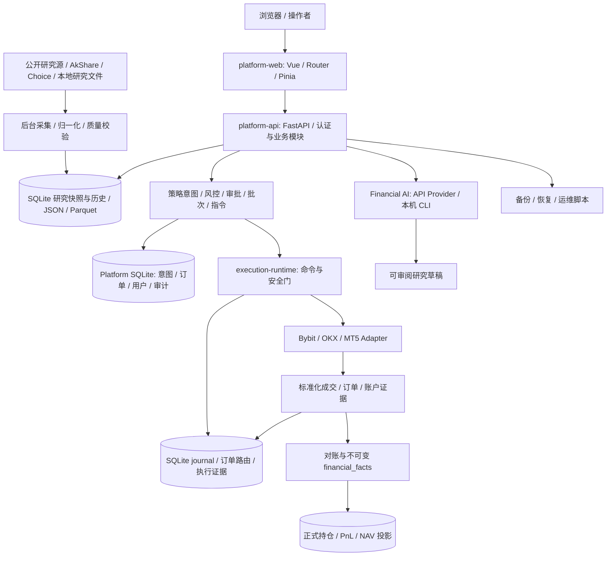

# 全球变量平台只读技术审计

审计日期：2026-11-03 晚至 2026-11-04（北京时间）。对象：当前工作区，包含审计开始时已有的未提交及未跟踪文件。基准 HEAD：`fcaeb9f180d17647960e5016da8d3ef6452022f0`，工程版本 `0.11.4`。

## 结论与边界

确认 7 项可复现的实现缺陷：4 项 P1、3 项 P2；另列 2 项 P2 验证缺口。最优先处理的是金融 AI 本机 CLI 权限边界、交易幂等对 symbol 的遗漏，以及财务投影的并发覆盖和非原子重建。没有据此宣称生产环境已被利用、发生错误交易或实际丢失财务事实。

本次仅新增本报告，未实施代码修复、Git 提交、部署、真实交易或外部服务验收。测试使用临时数据库、替身网关、隔离研究目录；本机 AI CLI 使用进程替身，未执行真实模型命令。审计开始时记录文件 SHA-256，结束时核对工作区漂移。本报告是当前源码的横切审查，不是逐行穷尽证明，也不是生产安全认证。

严重度：P1 表示影响权限隔离、交易意图或正式财务正确性，应优先修复；P2 表示在明确场景下导致功能、恢复、资源或验证失效。以下“复现”均为本地隔离复现，除明确标为静态检查外，不以字符串搜索替代运行证据。

## 模块、数据流与写入边界



| 模块 | 主要所有者与入口 | 数据与外部依赖 | 关键写操作 |
|---|---|---|---|
| Web | `platform-web/src/router`、`src/api`、`src/views` | Vue、Vite、Pinia、ECharts、Ant Design；HTTP Platform API | 个人布局、用户设置、研究偏好、交易操作请求；部分浏览器本地存储 |
| API 认证与业务 | `platform-api/app/application.py`、`auth.py`、用户/策略/风险路由 | FastAPI、Pydantic、Argon2、SQLite、HTTP Runtime | 用户与会话、授权、策略状态、订单、审批、审计 |
| 研究 | `research_routes.py`、`research_a_share_refresh.py`、`research_reference_boards.py` 等 | httpx、AkShare、Choice、公开行情/宏观/参考源、本地规范化数据 | 快照与历史、来源/质量字段、归档 JSON/Parquet、刷新状态 |
| 金融 AI | `financial_ai_routes.py` | 配置的模型 API；Codex/Claude/Qwen/DeepSeek 等本机可执行程序；RSS | 后端连接配置、模型调用和本机子进程；输出仅为研究草稿 |
| 交易编排 | `trade_commands.py`、`trade_command_execution.py`、`execution_batches.py`、`strategies/` | Platform DB、Runtime 版本化命令/事件协议 | 业务幂等键、订单与批次状态、派发、对账、异常恢复 |
| Runtime | `execution-runtime/app/main.py`、`command_routes.py`、`journal.py`、`runtime_recovery.py` | pybit/ccxt、MetaTrader5、Windows 终端进程 | 命令 journal、外部订单/撤单/配置变更、执行证据、研究行情 spool |
| 财务 | `financial_facts.py`、`financial_fact_repository.py`、`financial_projection_service.py` | Decimal、SQLite；导入及对账证据 | 不可变事实；可重建的 formal position/PnL/NAV |
| 运维 | `scripts/`、`deploy/`、`disaster_recovery.py` | PowerShell、Python、Caddy、本地进程和文件系统 | 启停服务、构建/发布、备份/恢复、数据库迁移或重置；本次未执行这些运维写操作 |

关键分界：研究值和 AI 草稿不能成为执行或会计事实；Platform 拥有业务意图，Runtime 拥有外部订单副作用。Live Write、Kill Switch、幂等、累计成交约束和 `result_unknown` 恢复边界应继续独立生效。本次未绕过这些边界测试真实账户。

## 按严重度排序的问题

### F01 — P1：只读平台权限可到达具有自动工具权限的本机 AI CLI

**位置**：`platform-api/app/financial_ai_routes.py:32`、`:79–83`、`:247–256`、`:280–284`；`platform-api/app/auth.py:343–346`。

**触发与根因**：`/financial-ai/chat` 只要求 `platform:read`，请求可选择 `mode=subscription, cli=qwen`。服务拼接用户 prompt/context，以 `--yolo` 启动本机 Qwen；DeepSeek 分支使用 `exec --auto`。进程没有显式限制 cwd、继承环境或操作系统权限。CLI 名称白名单防止任意可执行文件名，但没有限制所选 agent 的文件、工具与子进程能力；系统提示词也不是权限隔离。

**复现**：隔离 FastAPI 应用挂载真实 `AuthenticationMiddleware` 和金融 AI router，配置仅有 `viewer` 角色的 API key，保持可选 AI gateway key 未配置；将 `_cli_executable` 和 `asyncio.create_subprocess_exec` 替换为记录参数的无副作用替身。向 `/api/v1/financial-ai/chat` 提交上述 subscription 请求，得到 HTTP 200；记录 argv 包含 `--yolo`，kwargs 只有 stdin/stdout/stderr，未指定受限执行目录或环境。

**影响**：若服务器安装并登录对应 CLI，拥有研究读取能力的调用者可以把任意输入送入继承 API 进程权限的自动工具执行入口，可能访问本地文件、配置和凭据，产生本机写入或外部调用。此风险取决于所安装 CLI 的实际能力；本次没有运行真实 CLI、读取秘密或证明外部利用。

**修复建议**：将聊天推理与具备本机工具能力的执行分开授权；默认拒绝客户端任意切换到服务器 subscription agent。允许的执行模式必须显式关闭写工具/命令工具，设置最小环境、受限目录和系统级权限边界；无法可靠隔离的 CLI 不应作为普通研究聊天后端。保持服务器管理连接配置的既有权限检查。

**缺失测试**：viewer 对本机工具分支的拒绝；provider 模式越权切换；实际 argv/env/cwd；恶意 prompt 不得扩大工具权限。现有 `test_financial_ai_routes.py:108` 仅确认分析 POST 为 read 权限，没有验证该权限是否间接开放本机工具。

### F02 — P1：交易幂等比较遗漏 symbol，另一交易标的的请求获得原订单已成交结果

**位置**：`platform-api/app/trade_commands.py:79–83`、`:91–94`、`:249–264`；目录校验 `:62–76` 只确认 instrument 存在。

**触发与根因**：重用同一 idempotency key 时，比较策略、账户、instrument ID、方向、类型、数量和价格，却不比较 `request.symbol`。命令表也不保存该字段作为幂等指纹；早返回跳过后续执行校验。

**复现**：在临时 DB 初始化种子策略，替换 `app.runtime_transport.post` 为返回一笔填单事件的替身。首次提交 `instrument_btc_usdt / BTCUSDT`；用同一键及其他同样字段提交 `symbol=ETHUSDT`。

```json
{"firstStatus":"filled","replayStatus":"filled","sameCommand":true,"replayRequestedSymbol":"ETHUSDT","actualOrderSymbol":"BTCUSDT","runtimeCalls":1}
```

**影响**：幂等接口把不等价业务意图当作成功重放，调用者可能将原 BTC 成交误认为新 ETH 请求成功。该复现没有第二次派发、没有真实 ETH 交易，不能描述为“重复下单已经发生”。

**修复建议**：将执行语义字段纳入持久化的规范化指纹，至少包含 symbol；首次创建还应核对 instrument 与 venue symbol 的一致性。重放不一致请求返回 409，并保留并发唯一键冲突后的同一比较路径。

**缺失测试**：仅变更 symbol 的重放；大小写规范化；instrument/symbol 不一致；并发相同键不同 symbol。现有幂等套件不足以覆盖本次复现。

### F03 — P1：较早的财务投影计算可覆盖较新的完整投影

**位置**：`platform-api/app/financial_projection_service.py:49–53`、`:109–126`；`platform-api/app/financial_fact_repository.py:291–307`、`:356–373`。

**触发与根因**：读取事实、计算及 upsert 分属不同数据库连接/事务；写回没有事实版本水位或条件更新。SQLite 串行化短写事务并不能保证应用层读算写顺序。

**复现**：先写入同一策略/账户/instrument 的 funding 事实 5。线程 A 读取该事实后通过事件屏障暂停；主线程新增事实 7 并完成新投影，正式 PnL=12、fact_count=2。随后释放线程 A，旧快照 upsert 覆盖新值。

```text
before: total_pnl=12, fact_count=2, data_quality_state=complete
after:  total_pnl=5,  fact_count=1, data_quality_state=complete
storedFacts=2
```

**影响**：正式持仓/PnL 可能回退，同时仍宣称完整；依赖正式投影的财务页面与后续计算收到错误快照。事实表本身没有丢失，重建仍可能恢复。

**修复建议**：让同一投影键的事实快照与发布具有一致的事务/版本边界。可使用持久化事实序列水位与条件 upsert，拒绝旧版本覆盖；仅进程内互斥不足以保护多进程。不要以事件时间 `occurred_at` 充当递增版本，补录和同时间事实会破坏这种判断。

**缺失测试**：确定性线程屏障控制的旧计算晚发布；同时间/补录事实；跨进程并发；结果值和事实数一致性。

### F04 — P1：财务重建先提交删除，计算失败后留下空或部分正式投影

**位置**：`platform-api/app/financial_fact_repository.py:393–420`；`platform-api/app/financial_projection_service.py:130–145`；事务提交边界 `platform-api/app/database_connection.py:28–31`。

**触发与根因**：`prepare_strategy_rebuild` 删除正式持仓和 PnL 后退出 connection，上下文随即提交。各账户/instrument 随后独立重建；中途抛错不会回滚已提交的删除或已更新的其他分组。

**复现**：临时库中已有两条事实和可读正式 PnL；令 `rebuild_account_instrument_projection` 抛出 `RuntimeError` 后调用 `rebuild_strategy_financials`。捕获异常后，事实仍为 2 条，正式 PnL 行数为 0。

**影响**：一次恢复操作本身会破坏最后可用投影。异常退出或进程中断可能使用户读到空白或不同重建代际混合的数据，直至再次成功重建。不可变事实未被删除。

**修复建议**：在可回滚的同一事务中计算并发布，或先在隔离代际中生成、验证，再原子切换有效代际。保留最后成功结果；记录失败状态不能替代原子性。方案还需与 F03 的并发事实输入一起设计。

**缺失测试**：删除后第一组失败、第二组失败、发布前中断、重建期间并发读写；断言旧有效投影保留且不存在混合代际。

### F05 — P2：AI 流式连接取消时没有回收 CLI 进程

**位置**：`platform-api/app/financial_ai_routes.py:251–277`。

**触发与根因**：生成器只捕获 `TimeoutError`；没有处理取消/关闭的 `finally` 清理。超时分支 kill 后也没有等待退出。300 秒约束是每次 stdout read 的空闲超时，不是整个进程总时限。stderr 在进程退出前不被消费，持续 stderr 输出还可能使管道阻塞。

**复现**：以实现 stdout.read/wait/kill 的替身替换子进程；读取 `_cli_stream` 第一条 delta 后调用 `aclose()`。记录结果 `killed=False, waited=False`。该复现确认生成器关闭的回收缺失；未运行真实 AI 进程或人为耗尽机器资源。

**影响**：用户离开或重试聊天后旧工作仍可运行，反复请求产生后台进程、模型调用和资源占用；stderr 堵塞是该实现路径中的额外静态风险。

**修复建议**：在 `finally` 中终止并有界等待/回收所拥有的子进程及子进程树，保留正常退出语义；并行、有界消费 stderr；根据契约区分总执行时限与空闲时限。清理逻辑必须兼容请求取消。

**缺失测试**：客户端断开、任务取消、stdout 持续输出超过总时限、stderr 大量输出、kill 后 wait 和子进程回收。

### F06 — P2：执行读取缓存只判断 TTL，不淘汰变化输入形成的过期条目

**位置**：`execution-runtime/app/bybit_mt5_gateway.py:563–570`、`:604–634`；现有按账户清理仅在杠杆变更路径 `:125–133`。

**触发与根因**：margin 缓存键含数量及精确 reference_price，报价不断改变会产生新键。TTL 只控制命中是否复用，旧键不再被访问时也不会移除；字典没有容量上限。

**复现**：使用不联网的 Adapter，每次变化 reference_price，并模拟单调时钟每次推进 10 秒；调用 10,000 次 estimate_order_margin。缓存仍有 10,000 项，tracemalloc 当前约 6.47 MB、峰值约 6.73 MB。测量用于证明增长，不是生产内存预算或吞吐 benchmark。

**影响**：长期驻留 Runtime 在持续预检/估算时积累不可复用对象，最终增加内存压力；TTL 到期并不释放内存。杠杆变更偶尔清理并不能覆盖普通运行。

**修复建议**：在现有锁和 single-flight 机制内增加有界 LRU/过期淘汰；保持账户 generation 失效规则，不通过合并不同价格键降低估算精度。

**缺失测试**：大量不同报价且 TTL 已过期后的条目上限；淘汰与并发 loader 的一致性；账户失效后的旧 flight 不得重新注入。

### F07 — P2：工作台保存期间的新编辑被旧请求响应覆盖

**位置**：`platform-web/src/views/dashboard/workspace/PersonalWorkspace.vue:235–254`，尤其 `:248`；编辑入口 `:6–10` 仅禁用保存按钮。

**触发与根因**：保存发出的是当时 cards 的副本。请求未返回时，添加、删除和编辑仍可继续；成功回调无条件 `cards.value = r.items`。现有 generation 检查保护账号/加载代际，不能判断保存后发生的新编辑。

**复现**：使用真实 SFC 编译后的 setup 和 Vue ref，将 saveWorkspace 替换为可手动 resolve 的 Promise。初始卡片 A，调用 save 后删除 A；返回保存时的旧 items。

```json
{"duringSaveCards":0,"afterSaveCards":["a"],"notice":"已保存到当前账号"}
```

**影响**：旧卡片复活或新编辑丢失，同时出现保存成功提示。此为组件状态复现，未冒充真实浏览器验收。

**修复建议**：记录本地编辑版本，仅在与发出请求时相同的版本下应用服务端 items；否则仅更新服务器 rowVersion 并保留未保存编辑，或在保存期间统一禁用相关编辑入口。应明确覆盖删除、排序、替换和表单提交。

**缺失测试**：延迟保存响应期间删除/新增/修改；连续保存、账号切换、失败与版本冲突。需要补充真实交互断言，而不是只检查模板包含按钮。

### V01 — P2：若干回归测试与当前实现/契约脱节，关键路径的保护不可信

**位置**：`execution-runtime/tests/test_execution_warmup.py:59–89`；`platform-web/scripts/test-market-layout-persistence.cjs:33–121`；`platform-web/scripts/test-strategy-order-ownership.cjs:118–132`；`scripts/tests/test_live_acceptance_authority.py:46`、`:76`。

**复现与证据**：Runtime 套件 344 通过、1 失败。失败断言要求 specification 只调用一次，而 `bybit_mt5_gateway.py:498–501` 明确要求重读当前账户/终端交易权限，实际多一次 specification；这是测试预期失配，不应为让测试通过而缓存交易权限。Web 脚本有 11 个失败，其中 4 个布局测试因自制 require 桩无法解析 `researchWorkspace` / `dashboardSnapshotCache` 而在断言前失败；Funding 卡片测试同样无法解析 `FundingExitSettings.vue`。运维测试两项仍匹配历史固定 cap/追价参数文案。

**影响**：这些失败不能直接证明页面/交易行为失效，但会阻塞检查并掩盖真正回归；权限变化、布局隔离和交易组件等路径得不到预期保护。

**修复建议**：按当前拥有者契约修正测试预期；用实际模块加载/组件挂载代替脆弱的字符串与局部 require 桩。保留对权限变更、跨账户响应及交易边界的行为断言，不能简单删除失败测试或放宽安全检查。

**应补验证**：规格静态缓存与动态交易权限分别验证；所有新增组件依赖可加载；真实组件交互和 API 响应的契约断言。其他字符串断言失败逐项与产品契约核对，不能统一归类为误报。

### V02 — P2：现有静态检查未全绿，且局部通过不能覆盖整仓质量

**位置**：API `app/data_audit.py:815`、`:1246`、`:1257` 与 `app/research_a_share_repository.py:945`、`:969–978`；Web `src/components/Form/src/components/SelectAndInput.vue:43`、`src/components/Preview/src/Functional.vue:277`、`:287`；配置范围见两个服务的 `pyproject.toml`。

**复现**：API `ruff check app tests --no-cache` 报 192 项；配置范围内 pyright 报 8 项。Web 全量 vue-tsc 报 3 项，包含 defineProps 名称冲突及 Event/MouseEvent 不兼容；两个局部 Web tsconfig 通过，不能抵消全量失败。API 的 dict.update 报错属于推断类型约束，不能仅凭该诊断断言运行时一定抛错。

**影响**：当前工作区不能作为静态检查全通过的发布候选；新增业务路径可能不在局部检查范围内。这里记录的是检查可靠性及工程缺口，不把每项 lint 等价为生产事故。

**修复建议**：按当前模块修改范围处理真实类型不匹配和 lint，核查 pyright include 与新增模块覆盖；构建、局部类型检查、全量类型检查分别报告。治理规则与现有首页产品状态的冲突应在其拥有者处同步，不通过恢复过时占位页满足字符串检查。

## 测试与检查记录

所有 Python 命令使用对应服务 `.venv/Scripts/python.exe`。Python 测试通过临时 runner 调用原有 pytest，用临时 DB、关闭刷新/交易、替身网关、禁用 `.env` 读取、关闭 pytest cache，并拦截非测试外网 socket 和常驻服务端口。该隔离可能导致依赖真实环境的用例失败；失败必须单独归因。没有安装/升级依赖。

| 检查 | 运行方式 | 结果与解释 |
|---|---|---|
| Runtime pytest | 对原有 `tests` 执行隔离 `pytest -q -p no:cacheprovider` | 344 passed，1 failed，36.52 秒；失败见 V01 |
| API pytest | 首轮完整收集；之后按文件分为 4 个独立进程，保留原断言 | 分组结果见下方补充记录；首轮中止结果不计入合计 |
| API Ruff | `python -m ruff check app tests --no-cache` | 192 errors；未使用 `--fix` |
| API Pyright | `python -m pyright` | 8 errors；配置声明范围，并非整仓全覆盖 |
| Runtime Ruff / Pyright | 同上 | 均通过，Pyright 0 errors |
| 依赖一致性 | 两个环境 `python -m pip check` | 均通过；不是漏洞数据库扫描 |
| Web full types | `vue-tsc -p tsconfig.full.json --noEmit` | 3 errors，见 V02 |
| Web scoped types | strategy / user-system tsconfig，各加 `--noEmit` | 均通过 |
| Web 脚本测试 | `node --test --test-concurrency=1` 执行 test-*.cjs，排除 3 个需要独立副作用审查的文件 | 240 个测试单元，229 passed / 11 failed，162.30 秒 |
| Web Vite 核心构建 | 直接 Vite build，输出至临时 web-dist | 通过，44.13 秒；未运行会改写源文件的完整 npm prebuild/发布链 |
| Web codebase boundaries | `node scripts/check-codebase-boundaries.cjs` | 通过；有 3 个长文件维护提示 |
| API schema / Web 生成契约 | `export_strategy_openapi.py --check`；`generate-strategy-api.mjs --from-schema --check` | 均通过 |
| 版本与文档一致性 | check-version-consistency / check-documentation-consistency | 通过，版本 0.11.4 |
| 仓库结构 | `check-repository-structure.py` | 失败：既有顶层 outputs 未登记 |
| 产品数据边界 | `audit-production-data-boundaries.py` | 失败：首页缺少规则要求的 RestoredProductSurface 标记；需核对规则与当前工作台范围 |
| 数据所有者矩阵 | `audit-product-data-owner-matrix.py --require-closed` | 通过：22 项，21 verified / 1 explicit_unavailable；不是来源实时可用性的验收 |
| 研究模块化清单 | `audit-research-modularity.py` | 已运行，生成现状清单；不作为全系统验收 |
| 仓库脚本测试 | `pytest scripts/tests`，关闭 cache | 23 passed / 2 failed，11.28 秒；见 V01 |
| 秘密扫描 | `scan-secrets.py` | 8 处规则命中，主要为测试/启动脚本中的赋值；未输出秘密原文，也未将规则命中直接定为已泄露真实凭据 |
| 前端新增债务 | `frontend-no-new-debt.py` | SKIPPED：本地无 CI base SHA，不能记作通过 |
| 工作区差异格式 | `git diff --check` | 通过，exit 0；仅有 CRLF→LF 的 Git 提示，不能将其记为检查失败 |

Web 排除的文件为 `test-formal-view-registry.cjs`、`test-formal-route-manifest-core.cjs`、`test-strategy-query-browser.cjs`。未运行真实浏览器 E2E、生命周期/发布脚本、真实 API 常驻进程验收、外部数据刷新、真实 CLI 或交易所连通性验证。直接 Vite 构建不等于完整发布链通过。

Web 11 个失败：cross-spread funding-transfer 静态检查；cumulative-volatility-window 的旧状态引用；formal-route-manifest 聚合脚本；macro-chart-defaults 和 macro-china-layout 的顺序断言；market-layout-persistence 的 4 项依赖加载失败；strategy-account-wiring 静态检查；strategy-order-ownership 的组件依赖加载失败。原始日志保留各断言与堆栈。

### API 分组结果

四组已全部结束，原始结果合计 **1,601 passed / 40 failed（1,641 项）**。分组只按文件分配，没有改变测试断言；各组使用独立临时数据目录。

| 分组 | 测试文件数 | 通过 | 失败 | pytest 耗时 |
|---|---:|---:|---:|---:|
| 0 | 62 | 395 | 4 | 681.81 秒 |
| 1 | 58 | 394 | 11 | 824.81 秒 |
| 2 | 64 | 380 | 15 | 815.47 秒 |
| 3 | 58 | 432 | 10 | 976.59 秒 |

统计解释：上述 40 项是原始失败，不等于 40 个产品缺陷。其中研究 worker 的 spawn 用例受到本次临时 runner 缺少 `__main__` 保护影响；仅修正临时 runner 后，`test_strategy_research_worker.py` **3 passed（6.07 秒）**，该原始失败不归责于仓库。默认数据库路径用例继承了审计临时 `VG_DATABASE_PATH`，其“默认路径不符”同样不是已确认产品故障。没有为了使原始计数变绿而合并替换重跑结果。

其余失败包含固定 schema/seed/OpenAPI 哈希、权限或状态映射预期、数据库初始化替身、缺失 Runtime 行情/原生规则替身，以及 A 股生产断言。交易相关 403/409/503 不能只凭状态码认定为真实下单缺陷，也不能为通过测试放宽安全门。两项 Cross 后台退出测试超时的调用链仍具有 router lifespan 和 monitor，且评估需要原生交易规则；当前隔离结果不足以证明生产监控未启动。A 股相关测试还受到上述并发版本漂移影响。除 F01–F07 外，这些失败作为 **V01/V02 的 P2 验证问题或待归因证据** 保留，尚未确认为独立产品故障。

下表列出全部原始失败，以便逐项复现。行号优先取本轮失败堆栈；没有直接栈行时取当前测试定义。统一复现方式为在相同隔离 runner 下选择对应 node ID（表中路径去掉 `platform-api/` 后，加 `::` 和用例名）；使用新的临时 mode 目录，保持外网及真实交易关闭。修复方向：先补足合法前置数据/权限/transport 替身、核对当前拥有者契约，再定位仍失败的业务代码；不能直接更新哈希或删断言当作修复。

| 分组 | 文件与行号 | 失败用例 |
|---:|---|---|
| 0 | `platform-api/tests/test_browser_role_permissions.py:48` | `test_ceo_permissions_are_explicit_and_safety_gates_remain_independent` |
| 0 | `platform-api/tests/test_database_seeds.py:56` | `test_fixed_seed_snapshot_and_safety_defaults` |
| 0 | `platform-api/tests/test_operational_metrics.py:63` | `test_scrape_reads_existing_snapshot_without_writes_or_financial_labels` |
| 0 | `platform-api/tests/test_p1_catalog.py:245` | `test_cross_strategy_pnl_uses_canonical_fills_and_contract_multiplier` |
| 1 | `platform-api/tests/test_architecture_non_repository_sql_allowlist.py:47` | `test_non_repository_direct_sql_has_no_new_owner` |
| 1 | `platform-api/tests/test_cross_spread_fok_lifecycle.py:148` | `test_non_executable_limit_rejects_before_any_batch_submission` |
| 1 | `platform-api/tests/test_cross_spread_fok_lifecycle.py:197` | `test_clean_fok_close_no_fill_releases_plan_back_to_active` |
| 1 | `platform-api/tests/test_cross_spread_fok_lifecycle.py:256` | `test_uncertain_fok_close_enters_manual_intervention` |
| 1 | `platform-api/tests/test_database_bootstrap.py:15` | `test_schema_sql_checksum_and_compatibility_identity` |
| 1 | `platform-api/tests/test_database_bootstrap.py:46` | `test_initialize_database_preserves_bootstrap_before_seed_order` |
| 1 | `platform-api/tests/test_database_bootstrap_equivalence.py:94` | `test_fresh_database_schema_and_reference_seed_snapshot` |
| 1 | `platform-api/tests/test_database_connection.py:98` | `test_default_database_path_resolves_to_platform_api_data_from_any_working_directory` |
| 1 | `platform-api/tests/test_venue_reconciliation_policy.py:16` | `test_external_order_status_mappings_preserve_update_and_comparison_contracts` |
| 1 | `platform-api/tests/test_venue_reconciliation_schemas.py:56` | `test_model_json_schemas_match_pre_extraction_goldens` |
| 1 | `platform-api/tests/test_venue_reconciliation_schemas.py:73` | `test_reconciliation_openapi_fragment_matches_pre_extraction_golden` |
| 2 | `platform-api/tests/test_a_share_delivery.py:153` | `test_production_collects_once_preserves_missing_values_and_correct_periods` |
| 2 | `platform-api/tests/test_a_share_delivery.py:195` | `test_failed_modules_keep_stale_data_and_do_not_freeze_healthy_stocks` |
| 2 | `platform-api/tests/test_a_share_delivery.py:287` | `test_partial_index_refresh_preserves_prior_series_and_marks_missing_counts` |
| 2 | `platform-api/tests/test_architecture_production_data_boundaries.py:34` | `test_current_production_data_boundaries_are_clean` |
| 2 | `platform-api/tests/test_architecture_production_data_boundaries.py:52` | `test_random_value_generation_is_rejected` |
| 2 | `platform-api/tests/test_cross_spread_session_lifecycle.py:75` | `test_background_exit_survives_browser_end_and_application_restart[expired]` |
| 2 | `platform-api/tests/test_cross_spread_session_lifecycle.py:75` | `test_background_exit_survives_browser_end_and_application_restart[logout]` |
| 2 | `platform-api/tests/test_ops_observability.py:57` | `test_reconciliation_summary_reports_unknown_orders_and_manual_batches` |
| 2 | `platform-api/tests/test_ops_observability.py:86` | `test_audit_events_are_queryable_after_trade_command` |
| 2 | `platform-api/tests/test_order_safety_fail_closed.py:54` | `test_unknown_instrument_is_rejected_before_runtime_call` |
| 2 | `platform-api/tests/test_order_safety_fail_closed.py:71` | `test_quantity_must_follow_contract_specification` |
| 2 | `platform-api/tests/test_strategy_plan_adapters.py:112` | `test_funding_plan_rejects_market_policy_override` |
| 2 | `platform-api/tests/test_strategy_plan_adapters.py:164` | `test_live_funding_and_cross_spread_can_bind_the_same_logical_bybit_account` |
| 2 | `platform-api/tests/test_strategy_research_worker.py:31` | `test_spawned_serving_worker_publishes_and_resumes_original_cursor` |
| 2 | `platform-api/tests/test_user_permissions.py:47` | `test_ceo_browser_permissions_are_explicit_and_business_scoped` |
| 3 | `platform-api/tests/test_architecture_application_composition.py:17` | `test_application_is_a_bounded_composition_root` |
| 3 | `platform-api/tests/test_architecture_phase4_performance_tool.py:11` | `test_phase4_critical_path_tool_emits_repeatable_schema` |
| 3 | `platform-api/tests/test_cross_spread_observability.py:50` | `test_observability_aggregates_complete_read_only_sections` |
| 3 | `platform-api/tests/test_cross_spread_observability.py:83` | `test_observability_marks_failed_section_without_faking_zero` |
| 3 | `platform-api/tests/test_cross_spread_observability.py:112` | `test_fast_observability_skips_order_and_fill_history` |
| 3 | `platform-api/tests/test_live_trading_sessions.py:147` | `test_legacy_session_history_does_not_claim_normal_live_orders` |
| 3 | `platform-api/tests/test_live_trading_sessions.py:237` | `test_live_order_without_approved_session_reaches_runtime` |
| 3 | `platform-api/tests/test_live_trading_sessions.py:343` | `test_live_order_claim_ignores_legacy_session_notional_caps` |
| 3 | `platform-api/tests/test_secret_safety.py:83` | `test_all_accounts_must_be_active_before_order_submission` |
| 3 | `platform-api/tests/test_secret_safety.py:105` | `test_paused_demo_account_is_allowed_for_local_order_submission` |


## 证据位置与复现方式

本机审计临时目录：`C:/Users/jiuxi/AppData/Local/Temp/vg-readonly-audit-20261103/`。其中 `baseline.json` 保存开始时受审文件哈希；`*-tests.log`、`api-shard-*.log`、`*-pyright.log`、`*-ruff.log` 及各检查日志保存运行输出。原始日志未复制敏感配置到报告。

隔离复现脚本：`probe_findings.py`（F01/F03/F04/F05）、`probe_symbol.py`（F02）、`probe_cache.py`（F06）、`probe_workspace.cjs`（F07），对应输出为 `probes.log`、`symbol-probe.log`、`cache-probe.log`、`workspace-probe.log`。Python 脚本接收相应服务的绝对路径，Node 脚本接收 platform-web 绝对路径。若再次运行涉及 DB 的 probe，应先为其指定新的临时 DB 文件名，防止既有幂等事实影响复现；不对业务数据库运行。

并发审计漂移：开始时已有大量未提交修改；最终相比开始快照，`platform-api/tests/README.md`、`platform-api/tests/conftest.py`、`platform-api/tests/test_a_share_delivery.py`、`platform-api/tests/test_idempotency_conflicts.py`、`platform-api/tests/test_research_dashboard_cache.py`、`platform-api/tests/test_research_etf_observation.py` 的 SHA-256 不同。`platform-web/src/views/hedgeBoard/tradingTools/data/marketTools.ts` 在过程中一度变化，最终恢复为开始时的哈希。这些文件未由本次审计编辑，也未回退。测试结果反映各进程收集时的版本，尤其共享 conftest 的并发变化意味着不能声称整套结果对应单一不可变 commit；重要缺陷均给出了直接隔离复现，相关实现文件的最终哈希未变。后续修复验收应在稳定快照上运行。

## 建议修复顺序与文档影响

先关闭 F01 的本机工具权限越界路径，并修复 F02 的完整意图幂等；F03/F04 应合并设计财务投影的一致性和原子发布。随后处理 AI 进程回收、工作台编辑覆盖及 Runtime 缓存容量，同时修正失配测试与静态检查。每项修复以上述场景建立行为回归测试，保留交易安全门，不以 mock 通过替代真实部署验收。

文档影响：仅新增这份用户要求的审计报告；未改变产品范围、架构或运行契约，未修改 `docs/PROJECT.md` 及其他权威文档，也未写入新的生产完成状态。
